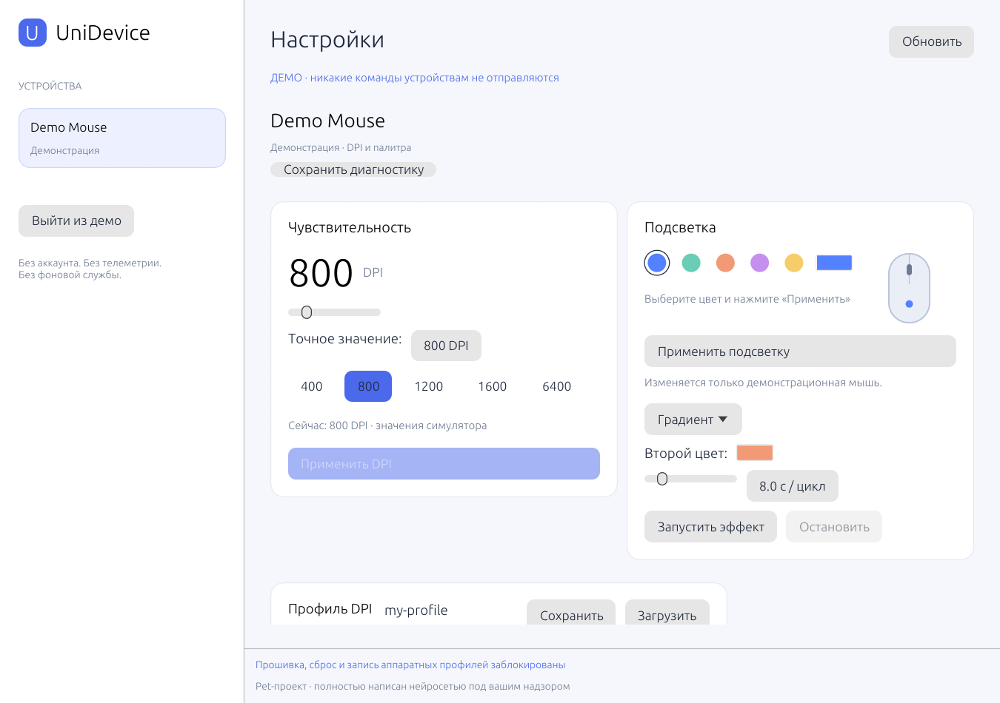

> **Это pet-проект, полностью написанный нейросетью под надзором автора проекта.**

# UniDevice 0.2

Минималистичное приложение на Rust для настройки периферии. Нативное окно, без
Electron/WebView, аккаунта, телеметрии и фоновой службы. Windows x64 и Linux desktop.



## Начать

1. Распакуйте portable-архив целиком в доступную для записи папку.
2. Windows: запустите **unidevice-gui.exe**. Linux: `chmod +x unidevice-gui`, затем `./unidevice-gui`.
3. Подключите мышь **кабелем USB**. Нажмите **Обновить** (или F5), если приложение уже открыто.
4. Выберите устройство слева. Для единственного подходящего кандидата проверка DPI запускается сама.
5. Выберите DPI и нажмите **Применить DPI**. Для Harpoon также выберите цвет и нажмите **Применить подсветку**.
6. Для анимации выберите **Градиент**, **Дыхание** или **Радуга**, задайте цикл
   4–30 секунд и нажмите **Запустить эффект**. Для градиента выберите второй цвет.
   **Остановить** прекращает смену цвета, оставляя последний оттенок.

Закройте G HUB/iCUE перед тестом: параллельные обращения могут мешать ответам устройства.
Слайдер, выбор пресета, обнаружение и загрузка профиля сами по себе устройство не меняют.
Приложение не добавляет себя в автозапуск и не продолжает работать после закрытия.

**Demo.cmd** (Windows) или `./unidevice-gui --demo` открывает симулятор без доступа к HID.
В демо работают DPI и палитра, но они меняют только состояние приложения.

## Что можно настроить сейчас

| Устройство / семейство | DPI | RGB |
|---|---|---|
| Проводное USB Logitech HID++2 с подходящим дескриптором и функцией 0x2201 | Экспериментальное чтение/изменение | Запись отключена |
| Logitech G PRO X SUPERLIGHT 1 по кабелю | Через тот же адаптивный механизм, если функция доступна | Декоративная RGB не реализована |
| Corsair Harpoon RGB PRO, прошивка 3.13 | Чтение и изменение активной ступени; проверено 1000 → 800 → 1000 | Цвет активной ступени; проверено красный → синий → красный |
| Gembird неизвестной модели | Не применимо к клавиатуре | Запись отключена до подтверждения протокола |
| Другой неизвестный протокол | Только обнаружение и диагностика | Только обнаружение и диагностика |

Автоадаптация не требует таблицы PID для каждой новой Logitech: приложение проверяет
дескриптор и запрашивает индекс функции и допустимые DPI. Незнакомый фирменный протокол
по одному HID-дескриптору расшифровать нельзя — такие команды не угадываются.
Приёмники, Bluetooth, onboard profiles, polling rate, remap и макросы пока не поддерживаются.

Harpoon проверена на подключённой мыши пользователя: DPI подтверждено чтением,
смена цвета — чтением и визуальным наблюдением пользователя. Диапазон 100–12000
с шагом 100 — ограничение приложения, не автоматически сообщённый список DPI.
Проверены значения 800 и 1000; остальные значения и сохранение после переподключения
отдельно не проверены. Другие прошивки Harpoon заблокированы до верификации.
Logitech пока **unverified**. Общая подсветка неизвестных устройств не угадывается.

## Защита устройства

Перед каждым аппаратным пакетом действует независимый фильтр. Разрешены только
документированные запросы HID++ DPI и изменение sensor 0 после чтения возможностей
и текущего значения. Для Harpoon разрешена только настройка её активной ступени
через проверенный feature-report протокол. Ответ записи проверяется повторным чтением.

- Нет команд прошивки, bootloader, сброса, pairing, flash и аппаратного сохранения профиля.
- Нет произвольных HID reports, IOCTL или экспериментального перебора команд.
- Нет повторов ошибочной записи, автоматического отката или применения при переподключении.
- Анимация отправляет ограниченные по частоте RGB-кадры только после явного запуска.
  Каждый кадр читает свежие настройки DPI и проверяет результат. Смена физической
  ступени DPI или ошибка останавливает эффект; применение DPI из приложения также останавливает его.
- При ошибке handle закрывается; для нового изменения нужна явная проверка устройства.
- GUI использует выбранный открытый handle, а не номер устройства, который мог измениться.
- Демо и неизвестные устройства не получают команд управления.

**Абсолютный нулевой риск обещать нельзя.** Фильтр ограничивает доступные операции, но не доказывает
отсутствие ошибок в сторонней прошивке. Спецификация: [specs/device-safety.md](specs/device-safety.md).

## Если устройство не поддерживается

Выберите его и нажмите **Сохранить диагностику**. Рядом с приложением появится
`unidevice-diagnostic-*.json`: VID/PID, HID usage и размеры/типы reports.
В нём нет серийных номеров, уникального USB-пути, нажатий клавиш или захвата ввода.
Экспорт ничего не загружает в сеть и не отправляет фирменные команды устройству.
Файл помогает определить следующий адаптер; сам по себе не подтверждает поддержку RGB.

## Профили

Поле **Профиль DPI** задаёт имя файла в папке `profiles` рядом с программой.
Используйте латинские буквы, цифры, дефис или подчёркивание. **Сохранить** создаёт новый
JSON; существующие файлы не перезаписываются. **Загрузить** меняет только значение в UI.
После загрузки применяется обычная проверка возможностей и явная кнопка **Применить DPI**.

## Linux

Для GUI нужны рабочая сессия X11/Wayland и драйвер OpenGL. Rust и SDK производителя
пользователю не нужны. Если нет доступа к hidraw, администратор может использовать
пример `70-unidevice.rules.example` с `TAG+="uaccess"`; приложение не меняет права само.
Не используйте глобальное `MODE=0666`.

## Сборка и тесты

Проверено с Rust 1.99.1. Нужен системный линкер (Windows MSVC Build Tools или MinGW-w64).
GUI — eframe/egui с OpenGL; ядро и CLI можно собрать отдельно без GUI-зависимостей.

```text
cargo test --locked --features gui
cargo fmt --check
cargo clippy --locked --all-targets --features gui -- -D warnings
cargo build --locked --release --features gui --bins
```

Windows: `scripts/Build.ps1 -Gui`, затем `scripts/Package.ps1`.
Linux CLI MUSL: `scripts/Build.ps1 -LinuxMusl`; GUI собирается нативно с `--features gui`.
Скрипты измерений: `scripts/Measure.ps1` и `scripts/Measure-Gui.ps1`.
Загрузка зависимостей — действие разработки; приложение сеть не использует.

Размер GUI EXE — около 3.5 МБ. Один Windows-замер в демо с запуском Hidden:
рабочая память ~99 МиБ, private ~51 МиБ, CPU ~0.04% от 8 логических процессоров.
Это не замер физического устройства; GPU/драйвер и платформа влияют на расход памяти.
Фактические результаты и ограничения: [REPORT.md](REPORT.md).

## Источники и происхождение

Сначала фиксируются спецификации в `specs/`, затем реализация. Официальные SDK и
проприетарные бинарники производителя не включены. Код community-драйверов не копируется.
Открытые библиотеки и их лицензии: [THIRD_PARTY.md](THIRD_PARTY.md), `licenses/`.
Один агент не является двумя независимыми clean-room командами.

История антивирусного детекта: [SECURITY_REVIEW.md](SECURITY_REVIEW.md). Пользователь
сообщил об отсутствии обнаружений при своей повторной проверке VirusTotal и поручил
продолжить разработку. Это не заменяет проверку безопасности HID-команд нового билда.

Приватный репозиторий: https://github.com/bimo0o/unidevice . Для коммерческого
распространения нужна юридическая проверка условий совместимости и лицензий.
